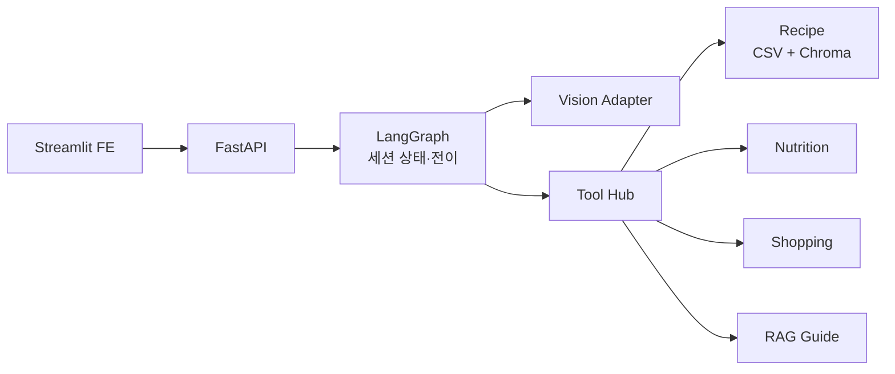
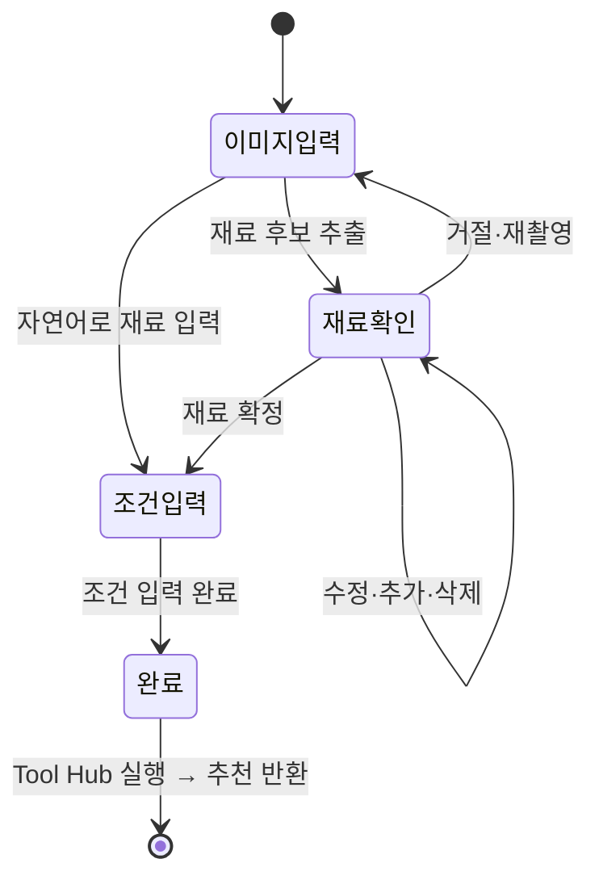

# 🥗 PlanEat

> 사진 한 장으로 나에게 맞는 혼밥 식단을 짜주는 AI 에이전트

<!-- [발표 가이드] 위쪽(1~7절)은 발표용, 아래쪽(📚 프로젝트 문서)은 GitHub 방문자용입니다. HTML 주석은 렌더링되지 않으니 발표자 메모로 사용하세요. -->

> 📌 **발표 내용**은 아래에서 바로 이어지고, 설치·API·구조 등 **프로젝트 문서**는 [여기](#-프로젝트-문서)에서 볼 수 있습니다.

---

## 1. 🎯 문제 정의

<!--
- 혼자 사는 사람은 냉장고에 재료가 있어도 뭘 해 먹을지 정하기 어렵다
- 그래서 있는 재료를 또 사거나, 재료를 남긴다
- 마무리 멘트: "재료는 있는데, 식단이 없다."
-->

- 🤔 무엇을 해 먹을지 **결정하기 어렵다**
- 🛒 이미 있는 재료를 잊고 **또 구매한다**
- ❌ 잘못 인식된 재료가 섞이면 **만들 수 없는 식단**이 나온다
- 🔁 다이어트·조리 시간 같은 **조건이 대화 중간에 추가**된다

## 2. ✨ 솔루션

<!--
- 입력: 냉장고 사진 / 영수증 / 자연어
- 출력: 레시피 2세트(세트당 5개) + 영양 + 부족 재료 + 장보기
- 핵심 한 문장: "사용자가 확인한 재료만으로 만들 수 있는 식단을 추천한다"
-->

| 입력 | 결과 |
| --- | --- |
| 📷 냉장고 사진 · 🧾 영수증 · 💬 자연어 | 레시피 **2세트 × 5개** · 영양 정보 · 부족 재료 · 장보기 목록 |

**핵심 한 줄:** 이미지에서 재료를 찾고, **사용자가 확인한 재료만으로** 실현 가능한 식단을 추천합니다.

## 3. 🎬 데모

<!--
- 순서: 이미지 업로드 → 재료 후보 확인·수정 → 조건 입력("다이어트, 20분 안에") → 추천 결과
- 결과 화면에서 BEST_MATCH / MORE_OPTIONS 두 세트가 나뉜다는 점을 짚기
- 실시간이 불안하면 GIF 로 대체. 인식이 틀려도 "그래서 확인 단계가 있습니다"로 연결
-->

<table align="center">
  <tr>
    <td align="center"><b>① 재료 확인</b><br></td>
    <td align="center"><b>② 영수증 입력</b><br></td>
    <td align="center"><b>③ 추천 결과</b><br></td>
  </tr>
</table>

## 4. 🏗️ 시스템 구성

<!--
- 한 줄로: Streamlit FE → FastAPI → ChatService → LangGraph → Tool Hub
- Tool Hub 안: Recipe(CSV+Chroma) / Nutrition / Shopping / RAG
- 역할: PM 조권식 / FE 이홍진 / BE·Tool Hub 박동준 / BE·Agent Orchestrator 최경락
-->



| 이름 | 역할 | 담당 영역 |
| --- | --- | --- |
| 박동준 | BE·Tool Hub | 외부 API 연동 지점 관리, 이미지 기반 재료 인식, Recipe·Nutrition·Shopping 기능, ChromaDB RAG 검색, Tool 호출 및 결과 관리 |
| 이홍진 | FE | Streamlit 화면 구현, 사용자 입력·이미지 수집, API 연동, 상태별 화면 전환, UI/UX 설계 및 테스트 |
| 조권식 | PM | 프로젝트 일정 관리, 요구사항 정리, 팀원 업무 조율, 데이터 전처리 및 초기 데이터 관리 |
| 최경락 | BE·Agent Orchestrator | FastAPI `/chat`, LangGraph Agent Flow·State, 세션 관리, Jev 기반 조건·재료 판정, Guardrails, 전체 결과 통합 |

## 5. 🤖 에이전트 동작 방식

<!--
[포인트 1] 안전 경계: 이미지 인식 결과는 '후보'. 확인된 재료만 추천에 사용 → 이 프로젝트의 차별점
[포인트 2] LangGraph 상태 전이: 이미지 입력 → 재료 확인 → 조건 입력 → 완료, session_id 별로 이어짐
[포인트 3] 정보가 모일 때까지 질문하고, 확정되면 Tool Hub 실행
-->

### 🔒 안전 경계

> 이미지 인식 재료는 **후보**입니다. **사용자가 확인한 재료만** 추천 · 영양 · 장보기 · RAG에 전달됩니다.

### 🔄 상태 전이



1. **이미지 입력** → 재료 후보 추출
2. **재료 확인** → 사용자가 추가·삭제·수량 수정
3. **조건 수집** → "다이어트, 20분 안에" 같은 조건을 대화로 누적
4. **추천 생성** → 확정된 재료·조건만으로 Tool Hub 실행 후 결과 반환

## 6. 💡 트러블슈팅 / 배운 점

<!--
- 실제 겪은 사례에 맞게 다듬어 말하기. 2~3개만 골라도 충분
- 질문 대비: "인식이 틀리면?" → 후보/확정 분리
-->

| 문제 | 해결 |
| --- | --- |
| 이미지 인식이 틀리면 추천 전체가 틀어짐 | 인식 결과를 **후보**로만 다루고 **확정 재료만** Tool에 전달 |
| 외부 판정 모듈(Jev)의 timeout · 저신뢰 응답 | **local fallback**으로 대화 흐름 유지 |
| 보조 기능(Chroma telemetry) 경고가 핵심 기능을 방해 | 보조 기능으로 **격리**해 추천·API는 계속 동작 |

## 7. 🚧 한계 & 향후 계획

<!--
- 마무리 멘트: "냉장고 속 재료를 낭비 없이 한 끼로."
- 이후 질의응답
-->

**현재 한계**
- 세션이 프로세스 메모리 기반 (재시작·멀티 인스턴스에 취약)
- 외부 Tool Hub / 별도 Vision 서비스는 아직 미연동 (adapter로 교체 지점 분리)

**향후 계획**
1. Redis/DB 기반 세션 저장소
2. 외부 Tool Hub endpoint 연동
3. 재고 · 유통기한 관리, 일주일 식단 · 장보기 추천
4. 취향 · 알레르기 기반 개인화

---

# 📚 프로젝트 문서

> 여기부터는 레포를 직접 실행하거나 연동하는 개발자를 위한 내용입니다.

## 프로젝트 개요

PlanEat Backend는 냉장고·영수증 이미지 또는 자연어 재료를 입력받아, 사용자가 확인한 재료와 식단 조건을
바탕으로 레시피·영양 정보·부족 재료·장보기 목록을 제공하는 FastAPI 기반 백엔드입니다.

**프로젝트 목표**

1. 냉장고·영수증 이미지와 자연어 입력을 모두 지원합니다.
2. 이미지 인식 결과를 후보로만 다루고, 사용자가 확인한 재료만 추천에 사용합니다.
3. 재료·조건·피드백을 `session_id`별로 이어가는 대화형 흐름을 제공합니다.
4. 레시피 2세트와 세트별 5개 레시피, 영양·부족 재료·장보기 정보를 한 번에 반환합니다.
5. 외부 Tool Hub가 아직 준비되지 않은 환경에서도 로컬 CSV·Chroma 기반으로 동작합니다.

## 기술 스택

| 영역 | 기술 | 사용 목적 |
| --- | --- | --- |
| Runtime | Python 3.11, `uv` | 실행 환경과 의존성 관리 |
| API | FastAPI, Uvicorn, Pydantic | 비동기 API와 DTO 검증 |
| Agent | LangGraph, LangChain Core | 상태 전이와 Tool node 실행 |
| LLM | OpenAI Structured Outputs | 재료·조건 구조화 |
| Decision | TypeSafe Jev (선택) | 사용자 응답의 의도(확인·수정·거절) 판정 보조 |
| Data | 내부 CSV, ChromaDB | 레시피 원본 · 의미 검색 |
| Safety | NeMo Guardrails, 자체 검사 | 입력 · 출력 · Tool 결과 차단 |
| Observability | LangSmith | 선택적 LangGraph 실행 trace |
| Output | ReportLab | 선택 식단 PDF 생성 |
| Test | pytest | 단위 · API · 통합 회귀 테스트 |

## 시스템 구성 상세

| 구성 요소 | 역할 |
| --- | --- |
| FastAPI | `/chat`, `/health`, PDF 다운로드 endpoint와 OpenAPI 제공 |
| ChatService | 요청 검증 이후 세션 · LLM · LangGraph · 응답 DTO 연결 |
| LangGraph | 대화 요약, 상태 전이, 완료 단계 Tool node 실행 |
| Vision adapter | 이미지에서 재료 후보를 구조화하여 추출 |
| Tool Hub | Recipe · Nutrition · Shopping · RAG 결과 조합 |
| 내부 CSV | 검증된 레시피 원본과 재료 중요도 제공 |
| ChromaDB | 레시피 의미 검색과 재료 가이드 보강 |
| Safety | 입력 · LLM 출력 · Tool 결과의 안전성 검사 |
| LangSmith | 원문 대신 비식별 실행 metadata를 선택적으로 tracing |

기본 Tool Hub는 프로젝트 내부 CSV와 사전 생성 Chroma 인덱스를 사용합니다. 외부 Tool Hub endpoint와 별도
Vision 서비스 endpoint는 아직 연동하지 않았고, adapter와 Tool node를 향후 교체 지점으로 분리했습니다.
`TOOL_HUB_ENABLED=false`일 때는 OpenAI 기반 임시 추천 경로로 fallback합니다.

**LangGraph 상태 전이**

| 내부 상태 | FE 단계 | 다음 동작 |
| --- | --- | --- |
| `WAITING_IMAGE` | `IMAGE_INPUT` | 이미지 또는 자연어 재료 입력 요청 |
| `WAITING_INGREDIENT_CONFIRM` | `INGREDIENT_CONFIRM` | 후보 확인 · 수정 · 거절 처리 |
| `WAITING_CONDITIONS` | `CONDITION_INPUT` | 식단 목적과 조건 추가 요청 |
| `COMPLETED` | `COMPLETED` | Tool Hub 실행 및 추천 결과 반환 |

`INPUT_REQUIREMENTS`는 이미지와 자연어 조건을 한 번에 수집해야 하는 초기 응답에서 쓰는 추가 단계이고,
`ERROR` 응답에는 `step`을 포함하지 않습니다.

## 로컬 실행

**요구사항:** Python 3.11 이상, [uv](https://docs.astral.sh/uv/), OpenAI API key (선택: LangSmith, TypeSafe Jev API key)

Linux/macOS:

```bash
cp .env.example .env
uv sync
uv run uvicorn app.main:app --reload --port 8000
```

Windows PowerShell:

```powershell
Copy-Item .env.example .env
uv sync
uv run uvicorn app.main:app --reload --port 8000
```

- Swagger UI: <http://127.0.0.1:8000/docs>
- OpenAPI JSON: <http://127.0.0.1:8000/openapi.json>
- Health: <http://127.0.0.1:8000/health>

## Chat API 요약

| Method | Path | 설명 |
| --- | --- | --- |
| `POST` | `/chat` | 세션별 대화 처리. 기본 JSON, `Accept: text/event-stream`이면 SSE |
| `GET` | `/health` | 서버 상태 확인 |
| `GET` | `/pdfs/{filename}` | 선택한 추천 세트의 상세 PDF 다운로드 |

요청 예시:

```json
{
  "session_id": "session-001",
  "message": "두부 1모와 계란 4개로 다이어트 식단을 20분 안에 만들어줘.",
  "attachments": []
}
```

`attachments`의 각 항목은 `type: "image"`, `data`를 가지며 한 요청에 최대 5개까지 허용합니다.

FE 분기용 상태:

| `status` | `step` | FE 동작 |
| --- | --- | --- |
| `NEED_MORE_INFO` | `IMAGE_INPUT` | 이미지 또는 자연어 재료 입력 |
| `NEED_MORE_INFO` | `INPUT_REQUIREMENTS` | 초기 입력을 한 번에 수집 |
| `NEED_MORE_INFO` | `INGREDIENT_CONFIRM` | 재료 후보 확인 · 수정 |
| `NEED_MORE_INFO` | `CONDITION_INPUT` | 식단 목표 · 조건 입력 |
| `SUCCESS` | `COMPLETED` | `data.recipe_sets` 표시 |
| `ERROR` | 없음 | 오류 표시 |

성공 응답은 `recipe_sets` 2개(각 5개 레시피)를 반환하며, 세트 선택 후에는 `pdf_url`을 사용할 수 있습니다.
표시 문구와 데이터는 `response`, `questions`, `ingredients`, `data`에서 읽습니다. 전체 요청·응답 형식은
[Chat API 명세](docs/api/chat.md)를 참고하세요.

## 소스 구조

```text
.
├── app/
│   ├── main.py                         # FastAPI 앱 생성·router 등록
│   ├── api/v1/endpoints/chat/          # POST /chat, PDF endpoint
│   ├── schemas/                        # 요청·응답 DTO와 검증 규칙
│   ├── agent/                          # LangGraph State·Workflow
│   │   └── tools/                      # Tool Hub·Recipe·Nutrition·Shopping Tool
│   ├── services/                       # 세션·대화·PDF 처리
│   ├── repositories/                   # 세션·데이터 접근
│   └── integrations/                   # LLM·Vision·CSV·Chroma·외부 연동
├── data/                               # 레시피 CSV·사전 생성 Chroma 인덱스
├── docs/
│   ├── images/                         # README 설명용 이미지 자산
│   ├── api/                            # API 계약
│   ├── architecture/                   # 구조·데이터 흐름
│   ├── integrations/                   # 외부 연동·안전성
│   └── operations/                     # 개발·운영 문서
├── mocks/chat/                         # FE 개발용 요청·응답 fixture
├── prompts/                            # 버전 관리되는 LLM 운영 프롬프트
├── guardrails/                         # NeMo Guardrails 설정
├── tests/                              # 단위·API·통합 테스트
├── pyproject.toml                      # 프로젝트·uv 의존성 설정
└── .env.example                        # 환경변수 예시
```

README 설명용 이미지는 [`docs/images/`](docs/images/)에, API 테스트용 냉장고·영수증 이미지는
[`mocks/chat/images/`](mocks/chat/images/)에 분리해 관리합니다.

## 환경 변수

전체 예시는 [`.env.example`](.env.example)에 있습니다. 실제 API key · token · 이미지 원문 · `.env` 파일은 Git에 커밋하지 않습니다.

| 변수 | 기본값 | 용도 |
| --- | --- | --- |
| `OPENAI_API_KEY` | 없음 | Vision · LLM 연동 |
| `OPENAI_MODEL` | `gpt-4o-mini` | 기본 OpenAI 모델 |
| `TOOL_HUB_ENABLED` | `true` | 로컬 Tool Hub 사용 여부 |
| `CHROMA_PERSIST_DIRECTORY` | `data/chroma` | 사전 생성 Chroma 인덱스 경로 |
| `CHROMA_AUTO_INDEX_ON_STARTUP` | `false` | 기동 시 전체 CSV 재색인 여부 |
| `NEMO_GUARDRAILS_ENABLED` | `true` | NeMo Guardrails 사용 여부 |
| `TYPESAFE_JEV_ENABLED` | `false` | TypeSafe Jev 선택 연동 여부 |
| `LANGSMITH_TRACING` | `false` | LangGraph tracing 여부 |
| `PDF_STORAGE_DIRECTORY` | `output/pdf` | 생성 PDF 저장 경로 |
| `PDF_IMAGE_TIMEOUT_SECONDS` | `60.0` | PDF 생성 시 레시피 이미지 1건의 다운로드 제한 시간(초) |

CSV를 의도적으로 변경해 재색인할 때만 아래 명령을 실행하세요.

```bash
PYTHONPATH=. uv run python scripts/index_recipe_catalog.py --persist-directory data/chroma
```

## 테스트

Linux/macOS:

```bash
PYTHONPATH=. uv run pytest
git diff --check
```

Windows PowerShell:

```powershell
$env:PYTHONPATH = "."
uv run pytest
git diff --check
```

## 참고 문서

- [Chat API 명세](docs/api/chat.md)
- [데이터 흐름](docs/architecture/data-flow.md)
- [구현 개요](docs/architecture/implementation-overview.md)
- [Tool Hub 연동 상태](docs/integrations/tool-hub-readiness.md)
- [Tool Hub 상세 연동](docs/integrations/tool_hub_integration.md)
- [NeMo Guardrails](docs/integrations/guardrails.md)
- [TypeSafe Jev](docs/integrations/jev.md)
- [LangSmith 연동](docs/integrations/langsmith.md)
- [온보딩](docs/operations/onboarding.md)
- [전체 문서 안내](docs/README.md)

FE fixture와 데모 이미지:

- [Chat fixture 안내](mocks/chat/README.md)
- [냉장고·영수증 fixture 이미지](mocks/chat/images/README.md)
- [이미지 요청 fixture](mocks/chat/request-image-base64.json)
- [성공 응답 fixture](mocks/chat/response-success.json)

## 개발 메모

- 재료 수량만 수정하는 응답은 기존 후보 목록에서 해당 재료의 수량만 교체하고 나머지는 유지합니다.
- LangSmith에는 사용자 메시지와 이미지 원문 대신 session hash와 비식별 상태 metadata만 전송합니다.
- Chroma telemetry 관련 라이브러리 경고가 발생해도 CSV 추천과 API 실행 자체를 중단하지 않도록 보조 기능으로 격리되어 있습니다.
- Chroma·PostHog 호환 버전 정리가 필요합니다.
